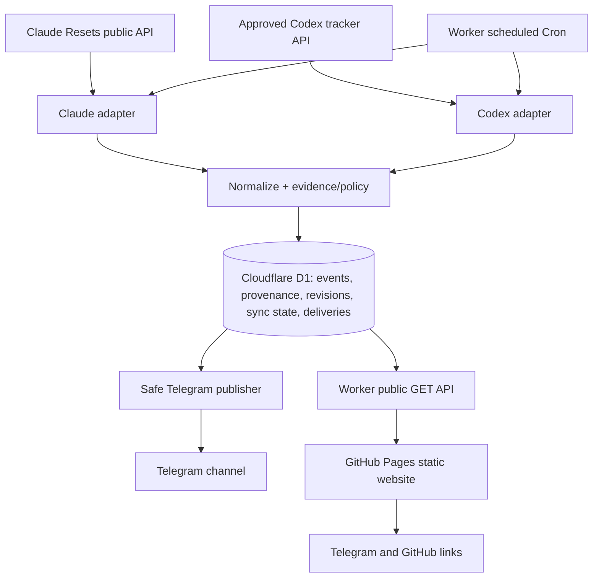

# 02 — Architecture: shared ingestion, two outputs



## Core invariants

1. **One D1 factual store**; Telegram and site are presentations of normalized accepted records. No browser fetch to community upstreams.
2. Cloudflare Worker **`scheduled()`** ingests on Cron and may publish **only with approval flags**. **`fetch()`** exposes safe read-only API; no publish/ingest side effect from requests.
3. Each upstream isolated in adapter and health; a failure must not delete or mark as retracted historic data.
4. `dry_run` defaults to on. Independent per-provider baseline and manual production publication activation.
5. D1 and Telegram cannot atomically commit together. Use atomic claims and manual handling of indeterminate delivery.

## Suggested file architecture AFTER Codex has been authorized to implement stages

```text
src/
  index.ts                   # scheduled + fetch entry points
  env.ts
  domain/{event,policy,stats}.ts
  providers/{types,claude-resets,codexreset}.ts
  services/{ingest,bootstrap,publish}.ts
  storage/{schema,d1,queries}.ts
  api/{router,events,status,stats,cors,cache}.ts
  telegram/{client,templates}.ts
  utils/{time,links,logging}.ts
migrations/                 # D1 schema; apply only with explicit approval
website/
  index.html
  package.json
  vite.config.ts             # base: /reset-radar/
  src/{main,api,types,i18n,styles}.ts
  public/                    # favicon, static OG image
.github/workflows/          # CI + owner-reviewed Pages deploy; Worker deploy separate
```

## Event model: our design, not upstream JSON

```ts
type Provider = 'claude' | 'codex';
type EventAction =
  | 'confirmed_applied' | 'announced_future' | 'banked_offer'
  | 'correction' | 'withdrawal' | 'needs_review';
type NormalizedEvent = {
  id: string; // stable internal namespaced ID
  provider: Provider;
  upstream: string;
  externalId: string;
  action: EventAction;
  rawKind: string | null;
  rawStatus: string | null;
  announcedAt: string | null; // exact ISO UTC if known
  effectiveAt: string | null;
  deliveredAt: string | null; // only evidence-backed
  dateOnly: string | null;    // YYYY-MM-DD; don't fabricate time
  audience: string | null;
  expiresOn: string | null;   // date-only if applicable
  sourceUrl: string;
  upstreamUrl: string;
  revision: string | null;
  contentHash: string;
  confidence: 'verified' | 'unverified' | 'historical';
  historicalSeed: boolean;
};
```

Proposed fields require Stage 0 verification and Stage 4 SQL review. Do not assume that external feeds use our enum names or field types. `confidence` is an internal evidence classification, not probability of a future reset.

## Two runtime paths

- **Scheduled:** read source snapshots conditionally → validate → normalize → evidence gate → save event/revision/source state → check approved transitions → claim delivery → Telegram send/record.
- **HTTP:** validate path/query → query D1 with prepared statements → create public JSON with calculated freshness and methodology labels → CORS/cache/ETag → reply. Never mutate event/publish state on public GET.

## Website data flow

Static HTML/CSS/JS served from GitHub Pages (free for public repos on GitHub Free). UI obtains `VITE_PUBLIC_API_BASE_URL` at **build time**, points at public Worker domain (e.g. `https://<actual-worker>.workers.dev`), never secret. Relative assets and page routing respect `/reset-radar/` unless own domain configured. API failures show last successfully loaded data in memory during current visit (if any), not fabricated updates.

## Scaling/cost

Cron uses ~8,640 scheduled runs per 30-day month; backend sends one Telegram message to channel per event regardless of subscriber count. Public site traffic adds Worker API reads; bound+cache stats and events requests to remain within Workers and D1 Free quotas. Monitor traffic, indexes and costs; zero-cost is an initial aim, not an SLA.
